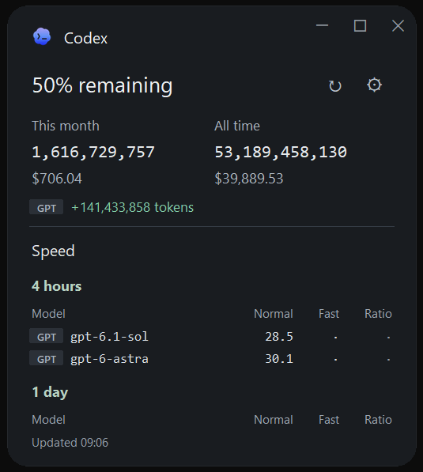
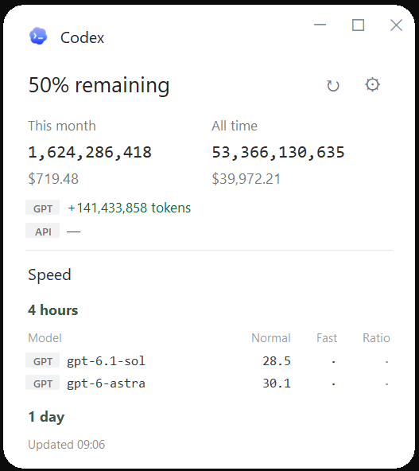

# Codex Meter

A small Windows and macOS desktop meter for Codex usage and speed. Close it to the notification area or menu bar and reopen it from the desktop shortcut.

<p>
  
  
</p>

*Codex Meter in dark and light mode.*

The current interface uses slightly larger text and wider outer padding. The window starts at 500 pixels wide and fits the first selected speed table with a little bottom space. Scroll down to see the other selected windows. Refresh does not resize the window. Side margins remain 28 pixels; muted gray window controls stay flush with the top-right edge. Period headings are plain text, without background boxes. The window uses a larger corner radius.

Appearance in Settings offers **System**, **Light** and **Dark**. System follows Windows' default app mode, including Custom mode. Light and Dark remain selected when Windows changes theme. Dark mode uses charcoal surfaces, lighter text and readable green, amber and red values. Switching appearance does not restart the app or scan logs.

The desktop shortcut, taskbar, tray, window and page header all use the same blue-purple gradient logo. The logo does not change with the theme. Its background and terminal cutouts use real alpha transparency, with no white box or checkerboard. The installer updates matching pinned shortcuts too. The selected PNG and multi-size ICO are in `assets/`.

Windows [registry change notifications](https://learn.microsoft.com/en-us/windows/win32/api/winreg/nf-winreg-regnotifychangekeyvalue) wake a waiting listener when theme preferences change. There is no periodic theme polling. If the preference or notification key cannot be read, startup falls back to light mode; opening from the tray checks the preference again. The app never changes your Windows theme settings.

## Quick install

### Windows

1. Download **[Codex-Meter-Windows-x64.zip](https://github.com/HenryTeo27/codex-meter/releases/latest/download/Codex-Meter-Windows-x64.zip)** from [Releases](https://github.com/HenryTeo27/codex-meter/releases/latest).
2. Extract the ZIP, then double-click **Install.cmd**. No administrator access or Python installation is needed.
3. Open **Codex Meter** on your desktop. The installer also adds it to the Start menu.


**Requires Windows 10/11 x64, Node.js 22+ with npm, and Codex installed.** Sign in with ChatGPT or an API key to show the available account information. Restart the app after installing Node.js so it can find `npx`. Codex Desktop's bundled CLI is detected when it is not on PATH. This app uses your local Codex logs; it cannot recover activity from other computers or deleted logs.

Python and the speed tool's libraries are included in the release. codex-speed is downloaded automatically on its first scan. First use needs internet access. Keep the entire extracted folder if running the app directly from `CodexMeter/CodexMeter.exe`; after installing, the extracted ZIP folder can be removed.

### macOS

Download the **macOS arm64** ZIP for Apple Silicon or **macOS x86_64** ZIP for Intel from [Releases](https://github.com/HenryTeo27/codex-meter/releases). Extract it and run `install-macos.command`. It installs `CodexMeter.app` under `~/Applications` and adds a desktop shortcut. Node.js 22+ and a signed-in Codex installation are still required. Python is included in packaged downloads. The supported build baseline is macOS 15 or later; older macOS versions are not verified.

The app uses macOS window controls, menu bar actions, Mac fonts and trackpad scrolling. Finder launches also search common Homebrew and Node installation paths. Settings and the latest snapshot are saved under `~/Library/Application Support/CodexMeter`. Appearance follows macOS notifications in System mode. Light and Dark can also be selected manually.

macOS builds are ad-hoc signed, not notarized with an Apple Developer account. macOS may require approval in **System Settings → Privacy & Security** on first launch. No developer certificate or notarization credential is included in this project. Do not disable Gatekeeper globally.

For a source installation, use Python 3.12 with Tk from python.org, clone this repository and run `sh install-macos.command`. The script creates a local environment and builds the app on your Mac. Apple Silicon and Intel have separate CI builds.

## Use

- Drag the Codex header to move the rounded window. Minimize, maximize/restore and close are in the page header; close hides it to the tray.
- **↻** refreshes usage, account limits and speed. Previous results stay visible while scanning. Hover over the status to see the next automatic refresh time or whether automatic refresh is off.
- **⚙** selects Appearance, manual refresh or every 30 minutes, 1, 2, 4, 6, 8 or 12 hours, and the all-time token adjustment. New installations default to 2 hours; saved choices are kept when updating. Dropdown choices save immediately. Valid token edits save after a short pause and are also saved when closing Settings or quitting. Save remains available. A new interval is measured from the most recent completed refresh; if already overdue, the app starts a refresh immediately.
- Only one app window runs at a time. Opening another copy restores the existing window, including one hidden in the tray.
- Closing the window hides it in the notification area. Use **Open**, **Refresh** or **Quit** from the tray menu.
- Hover over speed values for units and sample counts. Hover over the green token change for “Since Last Refresh” and the previous/current raw totals. Each successful usage response becomes the next baseline immediately, even while speed or account queries are pending. Manual and automatic refresh use the same baseline. A previous +150,000,000 followed by only 200,000 new tokens displays +200,000; the old increase is never added again.
- Remaining allowance uses the original percentage labels. Monthly and all-time usage combine enabled local accounts. Token changes appear on separate GPT / API lines. Speed tables prefix each model with the same short account name. Settings lists local accounts with immediately saved on/off switches; off hides the source and skips it on future refreshes.
- **Speed windows** in Settings offers independent **4 hours**, **1 day** and **14 days** checkboxes. Select any combination, including none. The default is 4 hours and 1 day, also applied to existing installations without a saved window selection. Only checked windows run on the next refresh, in that order. A 4-hour window covers the four hours before that scan, not four clock-hour blocks. The refresh interval controls when a scan starts and is independent of these windows.
- Switches save immediately. Changing a speed window does not start a scan. Cached results appear when available; a newly selected window without data shows “Available after next refresh.” Unchecked windows stay hidden. Settings ends with version and project details, without a provider list. There is no visible scrollbar on the main window.
- The app does not normally start with Windows. A downloaded pending update may resume once at the next sign-in. Scheduled scans run while the app is open or in the tray. Opening recent results shows the saved values immediately. Upgrading alone does not trigger a scan; scheduled refresh runs only when due.

## Install with Codex or from source

Ask your local coding agent:

> Clone https://github.com/HenryTeo27/codex-meter and run install.ps1 on Windows. Check Python 3.10+ with Tk, Node.js 22+ and my signed-in Codex installation. Install dependencies and create the desktop shortcut.

Or [download the source ZIP](https://github.com/HenryTeo27/codex-meter/archive/refs/heads/main.zip), extract it and double-click `Install.cmd`. Source installation needs Python 3.10+ with Tk; it can also use a supported Codex-bundled Python. It creates a private Python environment and installs `requirements.txt`.

```powershell
git clone https://github.com/HenryTeo27/codex-meter.git
cd codex-meter
powershell -NoProfile -ExecutionPolicy Bypass -File .\install.ps1
```

Both installers place the app in `%LOCALAPPDATA%\Programs\CodexMeter` and add desktop and Start menu shortcuts. To remove it, quit it and delete that folder and the two shortcuts. Settings and the latest snapshot are in `%LOCALAPPDATA%\CodexMeter`; delete that folder too if you want to reset everything.

## Repository migration

The main repository is now [HenryTeo27/codex-meter](https://github.com/HenryTeo27/codex-meter). The previous `HenryTeo27/ai-agent-usage-speed-app` repository remains as a compatibility endpoint for older installed apps and historical downloads. Its migration release moves existing installations to the new update address automatically. Issues and contributions belong in the main repository.

For an existing source checkout, run `git remote set-url origin https://github.com/HenryTeo27/codex-meter.git`. The local folder name and installed app data path can stay the same.

## Automatic app updates

An installed app checks for a stable release about every 6 hours. Starting the app, restoring it from the tray, opening an existing window from the desktop shortcut, returning focus and refreshing data also trigger a check when at least 1 hour has passed since the last completed check. These events share the same cooldown. Repeated clicks do not start concurrent checks or duplicate downloads. Hidden launches receive a startup check too. Checks run in a background worker; opening the app does not wait for the network. A failed check retries after 1 hour.

Downloads receive a SHA-256 check and a hidden startup check. Settings and the latest results are saved before installation. Once the window is hidden in the tray and its refresh finishes, the update installs and restarts in the tray. Quitting with a ready update installs it and leaves the app closed.

The verified archive is saved until installation. If Windows restarts first, a one-time sign-in entry resumes the update and returns the app to the tray. Opening the app also installs a saved update before showing the window. No general Windows autostart is enabled. The status tooltip shows update errors or when an update is ready.

If a replacement or the restarted app fails, the installer attempts to restore the previous version. The download is protected by HTTPS and the release digest, but releases are not code-signed. Source installations are converted to the packaged app during an automatic update; the desktop, Start menu and matching pinned shortcuts are updated. A development checkout or an executable run directly from an extracted ZIP does not update itself. Use the installer to enable updates.

## Data sources and calculations

| Display | Source |
| --- | --- |
| Remaining allowance | `100 − usedPercent` from each ChatGPT login's Codex `account/rateLimits/read` |
| This month / all time tokens and USD | `npx --yes ccusage@latest codex monthly --json` for each discovered home |
| Normal / Fast speed | [codex-speed by pszemraj](https://gist.github.com/pszemraj/f8fe69ff5002c3bd0825edfd02001635), enabled local accounts, selected rolling 4-hour, 1-day or 14-day windows |
| Ratio | Fast median effective tokens/s ÷ Normal median effective tokens/s |
| Green token change | Difference in raw all-time tokens between the latest two successful usage scans |

Costs are estimated API-equivalent costs from [ccusage](https://github.com/ccusage/ccusage), not your subscription invoice. They may use fallback model prices. Speed values are client-side estimates from local timestamps, including waiting, using samples with at least 100 output tokens. Different workloads, reasoning settings, context sizes and sample counts can change the comparison. Recorded Fast settings do not confirm server routing. A dot means no result. Ratios below 1 are dark red; 1 to below 1.5 are dark yellow; 1.5 and above are dark green.

### Accounts and local homes

The app looks for `~/.codex`, other `~/.codex*` directories containing Codex config, credentials or sessions, and the current or Windows-saved `CODEX_HOME`. To add homes elsewhere, set the Windows user environment variable `CODEX_METER_EXTRA_HOMES` to their full paths separated by semicolons, then reopen Settings. Each home appears under **Local Codex accounts**. Account names use compact neutral gray tags, aligned in the token-change area and speed tables. Models and numbers retain their usual colors; green token increases and speed ratio colors keep their existing meanings. GPT, API, GPT2 and API2 are short local source names; the directory and available plan details identify each entry in Settings.

Account switches save immediately. Disabled sources are excluded from displayed totals, deltas and speed rows and are skipped by subsequent refreshes. Manual and automatic refresh capture the enabled accounts and speed windows together at their start. A refresh already running finishes with that selection; changes apply to the next scan. Disabled accounts and unchecked windows keep their last cached results without collecting new data. Re-enabling a source displays its cached data until the next refresh. Its next token change compares against that source's last successful scan. An account without a previous successful scan first establishes its baseline.

Allowance labels show the first enabled ChatGPT source's usage windows in the original layout. Monthly and all-time token/cost totals sum enabled homes. Each source gets its own token-change line and its own model rows in the original speed tables. Hover over delta and speed values for raw comparisons, units and sample counts. API balances are not queried or displayed.

Usage, limits and speed start concurrently with one shared selection. Token scans for different enabled homes also run concurrently, with a maximum of three workers. Account limit queries run concurrently. Each source's token delta compares its latest two successful scans; an unavailable source retains its prior token result and reports a partial refresh.

Logs in one home can include activity from earlier logins, so local totals cannot always be attributed to its current account. Copies of the same sessions in different homes may be counted twice in the combined token totals and can appear under multiple source names in the speed tables. Keys or homes configured only inside another process or at an undisclosed custom location cannot be discovered automatically. OS credential-store logins are queried through Codex where available.

Credential values are not written to the snapshot. Source paths, short names, available account metadata and calculated results are saved there. The existing reserve adjustment is added once while a GPT source is included; disabling all GPT sources also removes that adjustment from the display.

**Reserve adjustment:** this manual correction covers a token gap when local logs capture only part of your `gpt-reserve` usage. The default `600,000,000` tokens is a personal estimate, not an audited total. Some reserve tokens are already counted, so an estimate can overlap with recorded usage.

[OpenAI describes Luna Reserve as GPT-5.6 Luna](https://help.openai.com/en/articles/20001499-luna-reserve-in-codex-and-chatgpt-work). [ccusage prices the `gpt-reserve` alias as that model](https://github.com/ccusage/ccusage/blob/main/docs/guide/codex/index.md). This pricing rule does not verify the actual routed model or recover missing token records. Local totals can differ from account-wide usage. The app does not assume that routing to another model caused a gap.

If OpenAI provides a comparable token total, subtract the raw logged all-time total before this adjustment. Use totals for the same account, devices and time period. Enter only that difference in Settings. The adjustment is added once to **all-time tokens only**. It changes neither monthly tokens nor USD costs. Set it to `0` for unadjusted counts.

Each refresh asks npm for the latest ccusage and downloads the latest upstream codex-speed script. The temporary speed copy receives a Windows timezone compatibility fix. A successful speed script is kept as an offline fallback; an existing local codex-speed installation can also serve as fallback. If latest tools are unavailable or incompatible, the status reports the fallback or failure. The app does not claim an older fallback is the latest version. Tool updates run upstream third-party code. Updating Codex itself and updating Codex Meter are separate steps.

## Storage and resource use

Settings and the last displayed snapshot live in the Windows per-user Local AppData folder, resolved through the Windows Known Folder API. Desktop launches, source runs and packaged runs share this location. Quit flushes valid Settings edits and the latest displayed data before closing; an empty session does not erase an existing snapshot. File operations retry brief access locks. A failed read or save is reported instead of silently treating it as a successful reset. Only the latest settings and snapshot are kept.

The app retains settings, one latest snapshot (including the last app-update check time), and one working speed-tool script. It does not keep a scan history or copy chat content. Speed CSVs, parse caches and downloaded app-update files are temporary. Existing Codex logs are read in place. npm maintains its normal package cache. No telemetry or chat upload is implemented. npm, the speed download, ccusage pricing resolution and the app-update check may access the network; the Codex account query uses Codex's existing sign-in.

The app sleeps between scans. While an automatic interval is selected, one lightweight timer checks the deadline at most once per minute; it does not scan or start workers until the refresh is due. This also catches clock changes and missed deadlines after sleep. Returning to the window checks immediately. A sleeping computer cannot run a scan; after waking, a due refresh starts within about a minute or when the window is opened. Manual mode has no usage deadline timer. The app-update deadline is checked at most once per hour, without network activity until it is due. Usage, limits and speed start concurrently outside the UI thread, and each source appears as soon as it completes. Only the affected values and table rows are updated; the app does not rebuild the page for each result.

The speed worker parses each enabled account once for all selected windows. It skips log files last modified before the longest selected window and computes only the checked reports. With the default selection, the file cutoff is 1 day instead of 14 days. With no speed windows or no accounts selected, the speed worker and its tool download are skipped. With no accounts selected, usage and limit commands are also skipped. Unchecking a window reduces the reports computed; removing the longest window can also reduce log reads. Recent files can contain older responses, so a shorter window does not guarantee a fixed reduction in scan time. orjson accelerates JSON decoding while codex-speed still computes the statistics. No persistent sample cache is written.

Each scan still reads local logs and briefly uses CPU, disk and memory; large log collections can take longer. The status shows pending sources and elapsed time. Completed refreshes show only the update time. Elapsed seconds appear only while a refresh is running. Hover over the status for any source errors or tool-update fallback details. Commands have timeouts. Failed sources retain their previous values and show a status message. A failed or partial attempt schedules the next automatic attempt from its completion time, avoiding repeated scans in a tight loop. This release is unsigned; Windows may identify the download as an unrecognized app.

## Development and build

```powershell
python -m venv .venv
.\.venv\Scripts\Activate.ps1
pip install -r requirements.txt
python -m unittest -v test_meter
pip install pyinstaller
powershell -NoProfile -ExecutionPolicy Bypass -File scripts\build.ps1 -Python (Get-Command python).Source
```

The ZIP is written to `release/`. It contains a folder-based executable bundle, installer, docs and dependency licenses. The automated Windows build is in `.github/workflows/windows.yml`.

Additional checks run without opening desktop windows or changing personal data:

```powershell
python scripts/check-persistence.py
python scripts/check-scheduling.py
python scripts/measure_resources.py --pid <main-process-id> --seconds 20
```

The persistence and scheduling checks also accept `--exe C:\path\to\CodexMeter.exe` to check a packaged app.

## Contribute other coding agents

Contributions for other coding agents are welcome. The current release supports **Codex only**. Help add your agent's usage and speed so one small app can show multiple platforms together.

Settings shows the installed app version, the GitHub repository link and an invitation to contribute. Codex Meter is open source under the MIT license.

Open an issue or pull request with the agent name, a link to its usage or speed tool, and a small anonymized log or JSON sample. Explain what the tokens, cost and timing values mean. Keep scans local, avoid storing history, handle missing fields, and include parser tests. Never include API keys, login files, chat content or personal logs. Provider data collection should stay separate from UI rendering so more agents can be added without duplicating the window.


## License and credits

Original code: [MIT](LICENSE). Third-party components retain their own licenses; see [THIRD_PARTY_NOTICES.md](THIRD_PARTY_NOTICES.md). Codex and OpenAI marks identify the service. This is an independent community app.

## Troubleshooting refresh

Packages built from a Codex Python runtime include its required certificate data file. TLS verification remains enabled, and the packaged smoke test creates a verified SSL context.

A tool-update fallback means current logs were scanned with an older working tool; it does not mean the displayed scan failed. A failed data source is reported as **Partial refresh**, keeps its previous value, and exposes the error on hover. Network access and log size affect timing. With several gigabytes of logs, a full ccusage scan can take longer than a speed scan.
